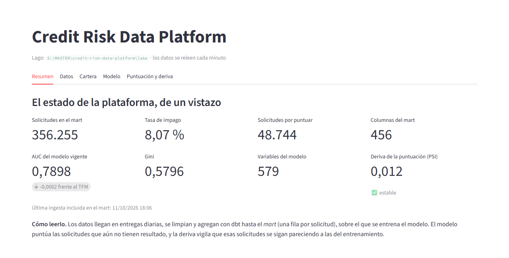
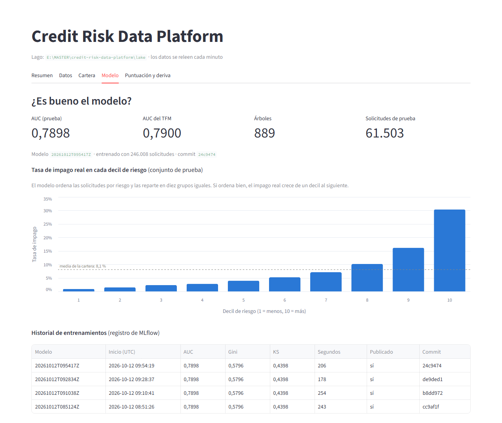
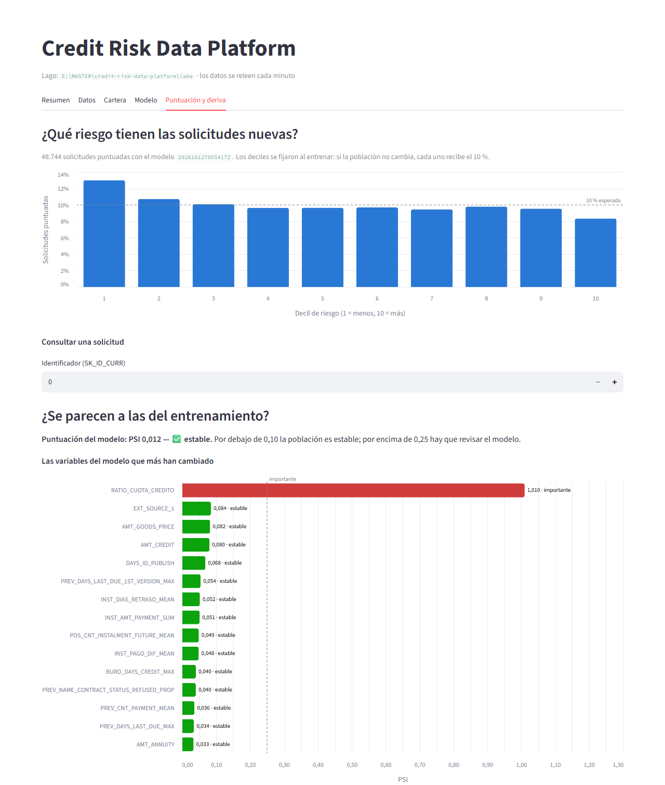
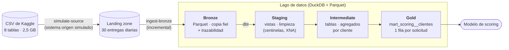
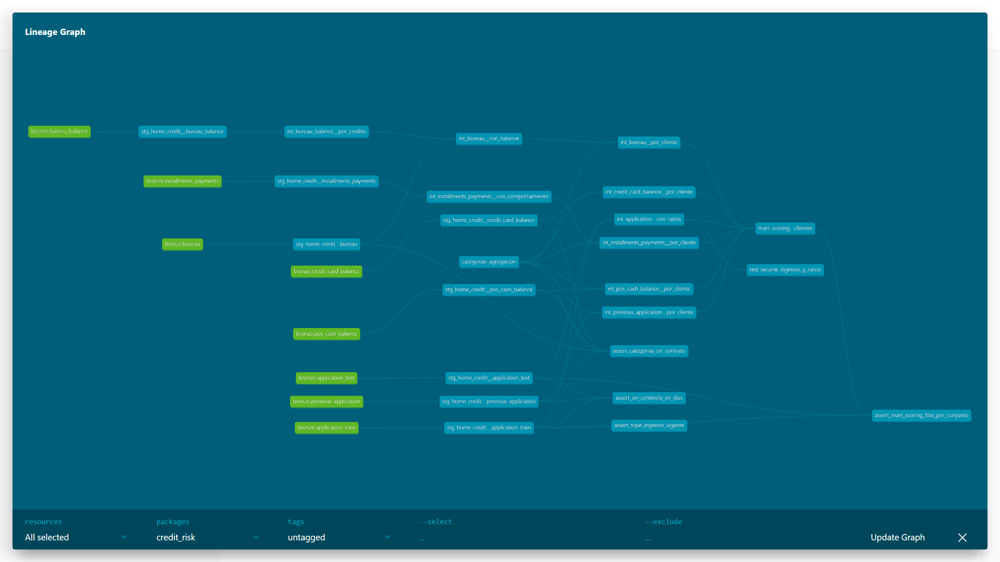
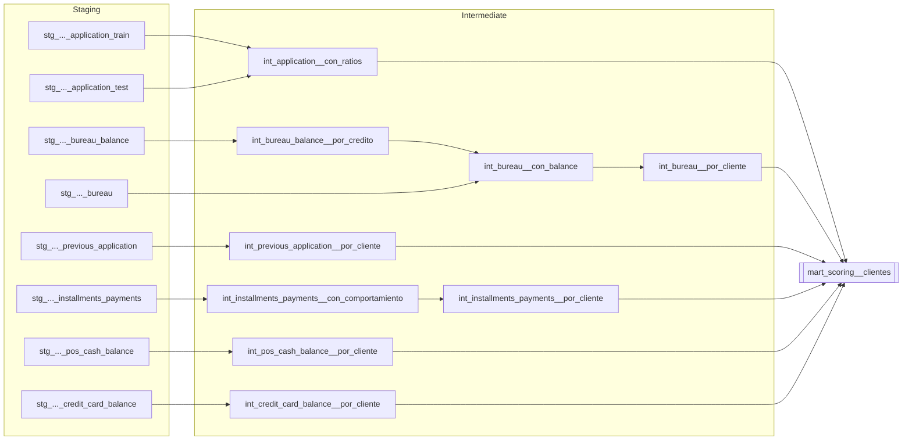
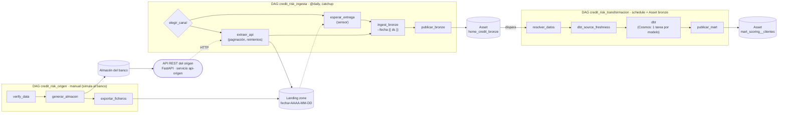
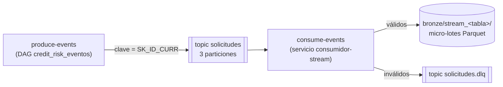
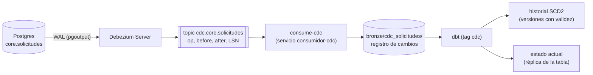

# Credit Risk Data Platform

🇬🇧 [English](README.md) · 🇪🇸 **Español**

[](https://github.com/att-22/credit-risk-data-platform/actions/workflows/ci.yml)

Plataforma de datos construida a partir de mi TFM de *scoring* crediticio
(dataset [Home Credit Default Risk](https://www.kaggle.com/competitions/home-credit-default-risk/data)).

El objetivo es llevar la ETL del TFM —hecha en notebooks con pandas— a un
proyecto de ingeniería de datos profesional: código versionado, testeado,
orquestado y desplegable.

**Stack:** Python 3.13 · uv · DuckDB · Parquet · dbt (dbt-duckdb, dbt_utils,
dbt_expectations) · Apache Airflow 3 · astronomer-cosmos · FastAPI · httpx ·
Redpanda (Kafka) · confluent-kafka · PostgreSQL · Debezium · Apache Spark
(PySpark) · Delta Lake · pytest · ruff · pre-commit · GitHub Actions ·
Docker / Docker Compose · Terraform · LightGBM · MLflow · Streamlit

## Estado

- [x] Fase 0 — Bases: Git, empaquetado, tests, lint, CI con GitHub Actions, Docker
- [x] Fase 1 — Modelado de datos con dbt + DuckDB (arquitectura medallion)
- [x] Fase 2 — Orquestación con Airflow 3 (Cosmos, Assets, tests de DAGs)
- [x] Fase 3 — Ingesta realista: incremental, API, streaming y CDC
- [x] Fase 4 — Spark, Delta Lake y Databricks
- [x] Fase 5 — Cloud + Terraform + despliegue continuo (sobre AWS emulado; el despliegue a AWS real está listo pero desactivado)
- [x] Fase 6 — La plataforma en uso: modelo de scoring sobre el mart, puntuación por lotes y monitorización de deriva

## Verlo funcionando en 5 minutos

Sin descargar nada de Kaggle y sin Docker: el repositorio trae una muestra sintética.
Solo hace falta [uv](https://docs.astral.sh/uv/), que instala el Python adecuado.

```bash
git clone https://github.com/att-22/credit-risk-data-platform.git
cd credit-risk-data-platform
export DATA_DIR=tests/fixtures/muestra      # la muestra sintética del repositorio

uv sync --group ml --group panel            # dependencias, con el modelo y el panel
uv run simulate-source                      # el "banco" deja 30 entregas diarias
uv run ingest-bronze                        # landing -> bronze (Parquet)
(cd transform && uv run dbt deps && uv run dbt build)   # bronze -> mart, con sus tests
uv run train-model --prueba                 # entrena el modelo sobre el mart
uv run score                                # puntúa las solicitudes sin resultado
uv run monitor-drift                        # las compara con la población de entrenamiento
uv run streamlit run panel/app.py           # abre el panel en http://localhost:8501
```

Tarda unos dos minutos. La muestra tiene 314 clientes con los valores barajados, así
que las cifras no significan nada (y con 52 solicitudes puntuadas, el panel avisa de
que la medida de deriva no es fiable); lo que se ve es el camino entero funcionando,
de los ficheros de origen al panel. Las capturas de este README son con los datos
completos.

## Panel

Todo lo que produce la plataforma acaba en ficheros Parquet; el panel es donde se ve.
Una aplicación de [Streamlit](https://streamlit.io) ([`panel/app.py`](panel/app.py))
lee directamente del lago y responde a cinco preguntas, una por pestaña:

| Pestaña | Pregunta | De dónde lee |
|---|---|---|
| Resumen | ¿Cómo está la plataforma hoy? | todo |
| Datos | ¿Llegan los datos? Filas por día de entrega y por tabla | tabla de control de bronze |
| Cartera | ¿Quién impaga más? Tasa de impago por contrato, estudios, edad, ingresos | el mart |
| Modelo | ¿Es bueno el modelo? Comparación con el TFM, historial de entrenamientos, impago real por decil de riesgo | MLflow y el modelo vigente |
| Puntuación y deriva | ¿Qué riesgo tienen las solicitudes nuevas y se siguen pareciendo a las del entrenamiento? | las puntuaciones y el informe de PSI |

```bash
uv run --group panel streamlit run panel/app.py     # http://localhost:8501
```



La pestaña del modelo enseña por qué sirve la puntuación: la tasa de impago real va
del **0,9 % en el decil de menos riesgo al 30,4 % en el de más**, unas 33 veces más.



La pestaña de deriva enseña la puntuación estable junto a la única variable que ha
cambiado:



Las consultas están en [`panel_datos.py`](src/credit_risk/panel_datos.py), separadas
de la aplicación, y por eso se prueban con pytest; la aplicación se prueba sin
navegador. Las capturas son con los datos completos.

## Arquitectura

Arquitectura *medallion* en un lago de datos local: cada capa tiene una
responsabilidad única y se construye a partir de la anterior.



| Capa | Herramienta | Qué hace |
|---|---|---|
| **Landing** | `simulate-source` ([simulate_source.py](src/credit_risk/simulate_source.py)) o `extract-api` ([extract_api.py](src/credit_risk/extract_api.py)) | El origen simulado reparte los CSV en 30 entregas diarias (`fecha=AAAA-MM-DD/<tabla>.csv.gz`), con cada cliente y todo su historial en el mismo día, sin perder filas. Llegan como ficheros o se extraen de su API REST. |
| **Bronze** | `ingest-bronze` ([ingest.py](src/credit_risk/ingest.py)) | Ingesta **incremental**: solo las entregas que no están en la tabla de control. Parquet particionado por `fecha_entrega`, tipos fijados por un contrato de esquema ([esquemas_bronze.json](src/credit_risk/esquemas_bronze.json)), columnas `_ingested_at` y `_source_file`. Atómica e idempotente. |
| **Staging** | dbt, vistas | Limpieza sin cambiar la granularidad: el centinela `365243` de las columnas `DAYS_*` y el código `XNA` pasan a `NULL`. |
| **Intermediate** | dbt, tablas **incrementales** | Agregación del historial a una fila por cliente (media, máximo, mínimo, suma y proporción de cada categoría). Las columnas numéricas se descubren por introspección; las categorías salen de un contrato fijo (*seed*). Cada ejecución solo recalcula los clientes con datos nuevos. |
| **Gold** | dbt, tabla **incremental** | Solicitud + ratios financieros + recorte de ingresos a un tope congelado (p99,9 de train) + los 5 historiales agregados. Train y test en la misma tabla (columna `CONJUNTO`). |

### Linaje de los modelos dbt

La documentación de dbt (cada modelo, sus columnas, su SQL y sus tests, y el grafo de
linaje navegable) se publica en GitHub Pages con cada cambio:
**[att-22.github.io/credit-risk-data-platform](https://att-22.github.io/credit-risk-data-platform/)**



Una vista simplificada del mismo grafo:



El grafo interactivo se genera con `dbt docs generate && dbt docs serve`.

## Calidad de datos

`dbt build` ejecuta **58 tests de datos y 1 test unitario** intercalados con los modelos:

- **Claves:** `unique` / `not_null` en cada modelo y clave compuesta
  `(SK_ID_BUREAU, MONTHS_BALANCE)` en `bureau_balance`.
- **Integridad referencial** (`relationships`): todo cliente con historial
  tiene solicitud (`error`). Los créditos huérfanos del propio dataset se
  reportan como `warn`: 43.041 en `bureau_balance` y 37.422 en `pos_cash_balance`.
- **Reglas de negocio:** rangos (`EXT_SOURCE_*` ∈ [0, 1], `DAYS_BIRTH` < 0,
  cuota ≤ crédito...), valores aceptados y nº de filas del mart por conjunto.
- **Deriva y esquema:** tasa de impago entre 7 % y 9 % (`warn`), nº de
  columnas del mart fijo, categorías del origen dentro del contrato (`warn`) y
  tope de ingresos congelado vigente: el p99,9 actual a menos de un 10 % (`warn`).
- **Test unitario** de la lógica de ratios y del recorte de ingresos con datos
  inventados (sin depender de los datos reales).
- **Frescura** de las fuentes con `dbt source freshness` sobre `_ingested_at`.

### Carga incremental

Los agregados por cliente y el mart son modelos **incrementales** (`delete+insert`
por clave): cada ejecución recalcula solo los clientes con filas ingeridas
después de la última (marca de agua sobre `_ingested_at`, la hora de ingesta, no
la fecha de los datos, para no perder entregas tardías), y siempre con todo su
historial. [`comprobar_paridad_incremental.py`](scripts/comprobar_paridad_incremental.py)
carga los datos en tandas, simula una entrega tardía y comprueba que el mart es
idéntico al de una reconstrucción completa (`--full-refresh`); se ejecuta en la CI.

## Orquestación con Airflow

El pipeline se orquesta con **Apache Airflow 3** en Docker Compose. Un DAG
simula el sistema origen; la ingesta es **diaria** (cada ejecución procesa la
entrega de su fecha lógica) y está conectada con la transformación por
**Assets**: la transformación no se programa por horario, sino cuando la
ingesta publica datos nuevos en bronze.



- **Ingesta por fecha lógica:** la ejecución del día X ingiere la entrega del
  día X (`{{ ds }}`), así que relanzar una ejecución (*Clear*) o hacer un
  *backfill* de un rango reprocesa exactamente esos días. Con `catchup=True`, al
  activar el DAG se crea una ejecución por cada día del periodo simulado.
- **Dos canales de entrada** (parámetro `canal`, bifurcación con `@task.branch`):
  - `ficheros`: el sensor `esperar_entrega` comprueba cada 30 s que el origen
    haya dejado la entrega completa y, mientras espera, libera su hueco
    (`mode="reschedule"`).
  - `api`: [`extract-api`](src/credit_risk/extract_api.py) descarga la entrega
    de la [API del origen](src/credit_risk/api_origen.py) (FastAPI, clave en
    `X-API-Key`, paginación por cursor) con reintentos ante 429/5xx (*backoff*
    exponencial con *jitter*, respetando `Retry-After`) y verificando el total de
    filas. Deja la entrega en la *landing* con el mismo contrato, así que el resto
    del pipeline no cambia. La API simula un 5 % de fallos para ejercitar los reintentos.
- **Assets con metadatos:** el evento de bronze lleva qué conjunto se ingirió
  (`muestra` o `completo`); la transformación lo lee y procesa ese mismo conjunto.
  Cada conjunto tiene su propio lago, así una prueba nunca pisa los datos completos.
- **[astronomer-cosmos](https://github.com/astronomer/astronomer-cosmos):** lee el
  `manifest.json` de dbt y crea una tarea por modelo (con sus tests) y una por
  cada test que depende de varios modelos. Cada modelo tiene sus propios logs y
  reintentos, y se puede relanzar solo una parte del grafo.
- **Pool `duckdb` de 1 hueco:** DuckDB admite un único proceso escribiendo, así
  que las tareas que lo usan se ejecutan de una en una.
- **Imagen propia:** Airflow y el proyecto (dbt, pandas...) viven en entornos
  virtuales separados dentro de la imagen para que sus dependencias no choquen.
- **Tests de los DAGs en la CI:** 52 tests que cargan los DAGs dentro de la
  imagen de Airflow y comprueban su estructura (Assets, pool, una tarea por
  modelo del manifest, reintentos, comandos existentes en la imagen...).

## Streaming con Redpanda (Kafka)

Además de las entregas diarias, el origen puede publicar cada solicitud como un
**evento** en el topic `solicitudes` de [Redpanda](https://redpanda.com/)
(compatible con la API de Kafka). Un consumidor que corre siempre los escribe
en bronze en micro-lotes.



- **Productor** ([productor.py](src/credit_risk/productor.py)): `acks=all` e
  idempotencia (los reintentos de red no duplican); la clave `SK_ID_CURR` lleva
  todos los eventos de un cliente a la misma partición, en orden.
- **Consumidor** ([consumidor.py](src/credit_risk/consumidor.py)): grupo de
  consumidores con *commit* manual **después** de escribir cada micro-lote
  (*at-least-once*: ante una caída no se pierde nada, pero puede repetirse);
  validación contra el mismo contrato de esquema que la ingesta por lotes; los
  eventos inválidos van a una **dead letter queue** con el motivo en una cabecera;
  parada ordenada ante `SIGTERM`.
- **Duplicados:** se eliminan al leer por `_evento_id`, porque también pueden
  venir de republicar un día (offsets nuevos), no solo de relecturas.
- **Tests de integración** contra un Redpanda real en la CI: DLQ, caída entre la
  escritura y el *commit* (verificada con una mutación que confirma antes de
  escribir y pierde eventos) y republicación.
- Consola web de Redpanda (topics, mensajes, grupos): http://localhost:8082.

## CDC: captura de cambios de la base de datos del banco

La aplicación del banco guarda el estado vivo de cada solicitud en Postgres
(`core.solicitudes`) y lo va cambiando (recibida → en revisión → aprobada o
rechazada; algunas se borran). **Debezium** lee el WAL de Postgres por
replicación lógica y publica cada `INSERT`, `UPDATE` y `DELETE` en Redpanda, sin
cargar la base de datos con consultas y sin perder cambios intermedios.



- Bronze guarda el **registro completo de cambios**, no solo el estado final; el
  **LSN** (posición en el WAL) los ordena y sirve para deduplicar (el consumo es
  *at-least-once*, con el mismo bucle que el streaming).
- dbt construye el **historial SCD tipo 2** (cada versión con su intervalo de
  validez, para consultas "¿en qué estado estaba el día D?") y la **réplica** del
  estado actual. Los modelos se activan con `--vars '{con_cdc: true}'`.
- [`comprobar_replica_cdc.py`](scripts/comprobar_replica_cdc.py) compara la
  réplica con la tabla real de Postgres y verifica que cada solicitud tenga todas
  sus versiones: perder *inserts* no cambia el estado final, pero sí el historial.
  Se ejecuta en la CI con Postgres, Debezium y Redpanda reales.

## Spark

[`spark_jobs/agregados.py`](spark_jobs/agregados.py) reimplementa en PySpark las
agregaciones de las tablas más grandes (`bureau_balance`, 27 M filas;
`installments_payments`, 13,6 M) y
[`comprobar_paridad_spark.py`](scripts/comprobar_paridad_spark.py) verifica que
el resultado es idéntico al de dbt. Spark se ejecuta en un contenedor (no hace
falta Java en Windows):

```bash
docker compose run --rm --service-ports spark spark-submit /opt/spark-jobs/agregados.py --explicar
```

Con estos datos (~530 MB) DuckDB es unas 5 veces más rápido: Spark paga un coste
fijo (JVM, planificación de tareas, *shuffle*) que solo compensa cuando los datos
no caben en una máquina y hay que repartir el trabajo entre varias.

### Delta Lake

[`spark_jobs/delta_lake.py`](spark_jobs/delta_lake.py) lleva bronze y el agregado
por crédito a **tablas Delta**: Parquet más un registro de transacciones
(`_delta_log/`) que añade garantías de base de datos:

- **ACID**: cada escritura es un *commit* atómico; nunca se lee una tabla a medias.
- **`MERGE`** (*upsert*): el agregado se actualiza de forma incremental solo con los
  créditos que tienen datos nuevos; una entrega tardía **actualiza** sus créditos
  (25.390 en la prueba con el día 15) en lugar de duplicarlos.
- ***Time travel***: cada *commit* es una versión que se puede volver a leer
  (`versionAsOf`): el "corte de lectura" de la Fase 3, de forma nativa.
- **Contrato de esquema**: escribir una columna que la tabla no tiene es un error.
- **`OPTIMIZE`**: compacta los ficheros pequeños que dejan los `MERGE`.

```bash
docker compose run --rm spark spark-submit /opt/spark-jobs/delta_lake.py cargar
docker compose run --rm spark spark-submit /opt/spark-jobs/delta_lake.py historia
uv run python scripts/comprobar_paridad_spark.py --delta   # Delta (leído con deltalake) frente a dbt
```

### Databricks

[`spark_jobs/databricks_demo.py`](spark_jobs/databricks_demo.py) es un notebook
en formato de Databricks que ejecuta lo mismo en **Databricks Free Edition**
(Spark *serverless*, Unity Catalog, Delta de serie): lee los CSV de un *volume*
con el contrato de esquema del proyecto, crea tablas Delta gestionadas, reutiliza
las funciones de `agregados.py`, construye el agregado por crédito con `MERGE`
(incluida una entrega tardía), muestra `DESCRIBE HISTORY`, `VERSION AS OF` y
`OPTIMIZE`, y **se comprueba a sí mismo** (el agregado incremental debe ser igual
al calculado de una vez). El mismo fichero se ejecuta en local y en la CI.

1. Crea una cuenta de Databricks Free Edition.
2. **Workspace → Create → Git folder** con la URL de este repositorio.
3. En **Catalog → workspace**, crea un esquema `credit_risk` con un *volume*
   `muestra` y sube `bureau_balance.csv` e `installments_payments.csv` de
   [tests/fixtures/muestra/raw](tests/fixtures/muestra/raw).
4. Abre `spark_jobs/databricks_demo.py` desde la Git folder y pulsa **Run all**
   (los *widgets* apuntan por defecto a `/Volumes/workspace/credit_risk/muestra` y
   `workspace.credit_risk`).

## Infraestructura como código (Terraform + AWS)

[`infra/`](infra) declara con Terraform la infraestructura de la plataforma en AWS:
un bucket S3 para el lago (versionado, cifrado AES256, acceso público bloqueado y
una regla de ciclo de vida que hace caducar `landing/`) y un rol IAM de mínimo
privilegio para el pipeline, que solo puede leer y escribir en las cuatro zonas del lago.

Funciona gratis y sin cuenta de AWS contra [Moto](https://github.com/getmoto/moto),
un emulador de AWS de código abierto; lo único que cambia respecto a AWS real es una
variable (`endpoint_aws`). Terraform se ejecuta en un contenedor:

```bash
docker compose --profile aws up -d moto        # emulador de AWS en el puerto 5000
docker compose --profile aws run --rm terraform init
docker compose --profile aws run --rm terraform apply -var-file=entornos/local.tfvars
uv run --group aws python scripts/comprobar_infra.py   # comprobación independiente con boto3
```

`scripts/comprobar_infra.py` no se fía de Terraform: pregunta a la API de AWS si el
bucket, las reglas de ciclo de vida y los permisos del rol son los declarados.

**El lago en S3.** Con `LAKE_URI=s3://<bucket>` la landing y bronze viven en el bucket
en lugar de en disco, y nada más cambia en el pipeline: DuckDB lee y escribe los datos
con `httpfs`, `pyarrow.fs` gestiona las carpetas con la misma API para disco y S3
([`lago.py`](src/credit_risk/lago.py)) y dbt usa un target `s3`. El almacén de dbt
sigue en local: almacenamiento y cómputo quedan separados.
`scripts/comprobar_paridad_s3.py` ejecuta el pipeline entero dos veces, en disco y en
S3, y exige el mismo bronze y el mismo mart, columna a columna.

**Despliegue continuo.** [`deploy.yml`](.github/workflows/deploy.yml) aplica `infra/`
en AWS real cuando un cambio de la infraestructura llega a `main`. No guarda claves
de AWS: GitHub Actions obtiene credenciales de una hora por **OIDC**, de un rol que
solo se deja asumir desde este repositorio y su environment `aws-dev`. El estado de
Terraform vive en un bucket S3 con bloqueo y el workflow aplica exactamente el plan
que ha calculado. Está desactivado hasta que se define una variable del repositorio;
[`infra/bootstrap/`](infra/bootstrap) crea lo que necesita y la CI ensaya los mismos
pasos contra Moto.
[infra/README.md](infra/README.md) tiene los detalles, las rarezas de Moto
encontradas por el camino y una tabla de equivalencias AWS / Google Cloud / Azure.

## Modelo de scoring

El mart no es el final del camino: [`modelo.py`](src/credit_risk/modelo.py) entrena
sobre él el mismo modelo que el TFM entrenó a partir de notebooks, en las mismas
condiciones (LightGBM con los hiperparámetros que se ajustaron allí y exactamente las
mismas 61.503 solicitudes de prueba, reproducidas ordenando el mart y con la misma
semilla).

| | AUC | Gini | Variables | Árboles |
|---|---|---|---|---|
| TFM (notebooks, pandas) | 0,7900 | 0,5800 | 583 | 1.002 |
| Plataforma (mart de dbt) | 0,7898 | 0,5796 | 579 | 889 |

Cliente a cliente, las puntuaciones de los dos modelos tienen una correlación de
Spearman de 0,993 y coinciden en el 93 % de las solicitudes que cada uno sitúa en el
10 % de más riesgo. Son dos implementaciones equivalentes; la diferencia es que esta
parte de SQL versionado y testeado, es incremental y está orquestada.

- **Preparación aprendida solo con el entrenamiento** (one-hot, eliminación de
  columnas vacías o constantes) y guardada con el modelo, para que los datos que se
  puntúen después reciban exactamente el mismo tratamiento.
- **Registro de experimentos con MLflow**: parámetros, métricas, ficheros, el commit
  y con qué versión del mart se entrenó cada modelo.
- **Control de calidad**: un modelo solo se publica como vigente si su AUC de prueba
  alcanza un mínimo; si no, sigue el anterior.

```bash
uv run --group ml train-model --auc-minimo 0.78
uvx mlflow ui --backend-store-uri sqlite:///outputs/mlflow.db --port 5001
```

### Puntuación por lotes

[`scoring.py`](src/credit_risk/scoring.py) aplica el modelo vigente a las 48.744
solicitudes del mart que aún no tienen resultado y escribe en el lago
(`warehouse/scoring/modelo=<id>/`) la probabilidad que les da el modelo y un decil de
riesgo, calculado con los cortes que se guardaron al entrenar. Una partición por
modelo: volver a puntuar con el mismo la sobrescribe, y un modelo nuevo conserva las
puntuaciones del anterior para poder compararlas.

```bash
uv run --group ml score      # 48.744 solicitudes en unos 8 segundos
```

En Airflow esto cierra el ciclo sin pasos manuales. `credit_risk_scoring` se programa
sobre **cualquiera de dos Assets**: el mart (datos nuevos) o el modelo (un modelo
nuevo publicado por `credit_risk_entrenamiento`, que se lanza a mano). Si todavía no
hay ningún modelo publicado, la ejecución se omite en lugar de fallar.

```
ingesta ==> bronze ==> transformación ==> mart ==>
                                                   scoring ==> puntuaciones
                    entrenamiento (manual) ==> modelo ==>
```

### Monitorización de deriva

Un modelo se entrena con una población y se usa con otra. Si la segunda se aleja de la
primera, sus puntuaciones dejan de ser fiables aunque nada "falle".
[`deriva.py`](src/credit_risk/deriva.py) lo mide con el **PSI** (*Population Stability
Index*), la medida habitual en riesgo de crédito (< 0,10 estable, 0,10–0,25 cambio
moderado, > 0,25 importante), a dos niveles:

- **La puntuación del modelo**: cada decil de riesgo debería tener el 10 % de las
  solicitudes. Es la alarma: por encima del máximo, el comando (y la tarea de Airflow)
  falla.
- **Las 30 variables que más pesan en el modelo**, contra una referencia que se guarda
  al entrenar. Es el diagnóstico: qué ha cambiado.

```bash
uv run --group ml monitor-drift
```

Con los datos reales (48.744 solicitudes puntuadas frente a 246.008 de entrenamiento)
la puntuación es estable, **PSI 0,012**, pero una de las variables principales no:
`RATIO_CUOTA_CREDITO` (cuota / crédito) tiene un PSI de 1,01. La causa está en los
propios datos de Kaggle: los créditos *revolving* son el 9,5 % de las solicitudes de
entrenamiento y solo el 0,9 % de las que se puntúan, y los préstamos en efectivo que
se puntúan tienen cuotas más altas respecto a su importe (mediana 0,062 frente a
0,048). Sin alarma, y con algo concreto que vigilar.

Con pocas solicitudes el PSI es ruido (las 52 de la muestra dan 0,54), así que por
debajo de 1.000 se escribe el informe pero no se da la alarma. En Airflow,
`vigilar_deriva` se ejecuta después de puntuar, en paralelo a la publicación: una
alarma no retiene las puntuaciones, avisa de que hay que revisar el modelo.

## Hallazgos sobre los datos

- **Centinela 365243** (= 1000 años) significa "sin dato" en 6 columnas
  `DAYS_*`. En `DAYS_EMPLOYED` son 55.374 solicitudes (jubilados y
  desempleados). Sin limpiarlo, la media pasa de −2.384 a +63.815 días.
- **Hay un cliente real con `SK_ID_CURR = 365243`.** El TFM reemplazaba el
  centinela en toda la tabla y le borraba el historial. Aquí se limpia
  columna a columna.
- **Paridad con el TFM:** 0 diferencias numéricas en las variables comunes. Las
  únicas discrepancias están explicadas: `sum()` de todo nulos (0 en pandas,
  `NULL` en SQL), el cliente 365243, y céntimos en `INST_PAGO_DIF` porque el
  TFM restaba en float32.

## Puesta en marcha

Requisitos: [uv](https://docs.astral.sh/uv/). uv instala la versión de Python adecuada.

```bash
uv sync                         # entorno virtual + dependencias (uv.lock)
cp .env.example .env            # y ajusta DATA_DIR a tu carpeta de datos
```

### Probar sin descargar los datos de Kaggle

El repositorio incluye una **muestra sintética** (314 clientes, 2,3 MB) en
[tests/fixtures/muestra](tests/fixtures/muestra), generada con
[scripts/crear_muestra.py](scripts/crear_muestra.py). Conserva las relaciones
entre tablas, los tipos y las categorías, pero los valores de cada columna
están barajados, así que ninguna fila corresponde a un cliente real. Es la que
usa la CI.

```bash
export DATA_DIR=tests/fixtures/muestra
uv run verify-data              # comprueba los CSV de entrada
uv run simulate-source          # CSV -> lake/landing (entregas diarias)
uv run ingest-bronze            # landing -> lake/bronze (solo las entregas nuevas)
cd transform
uv run dbt deps                 # paquetes de dbt
uv run dbt build                # modelos + tests (~2 s con la muestra)
```

### Con los datos completos

Descarga los CSV de [Kaggle](https://www.kaggle.com/competitions/home-credit-default-risk/data)
en `<DATA_DIR>/raw/`, define `DATA_DIR` en `.env` y ejecuta los mismos comandos
(sin el `export`). Con los datos completos, `dbt build` tarda unos 25 s.

### Airflow

```bash
docker compose up -d --build    # Airflow, API del origen, Redpanda, core bancario, Debezium y consumidores
```

Abre http://localhost:8080 (sin usuario: configuración solo para uso local),
lanza `credit_risk_origen` (genera las entregas del "banco": las sirve la API en
http://localhost:8000/docs y deja una copia en la *landing zone*) y activa
`credit_risk_transformacion` y `credit_risk_ingesta`: la ingesta procesa los 30
días uno a uno y cada día dispara la transformación. Por defecto se usa la
muestra; para los datos completos, lanza el origen con `datos = completo` y un
*backfill* de la ingesta con el mismo parámetro. Con `canal = api`, la ingesta
extrae las entregas de la API en lugar de esperar los ficheros. Para pararlo:
`docker compose down` (los volúmenes con el lago y el historial se conservan).

Compose lee `DATA_DIR` del archivo `.env`; con `datos = muestra` no hacen falta
los datos de Kaggle (la muestra sintética va dentro de la imagen).

### Docker

```bash
docker build -t credit-risk .
docker run --rm -v "<ruta a DATA_DIR>:/data:ro" credit-risk   # verify-data
```

En Git Bash (Windows) hay que anteponer `MSYS_NO_PATHCONV=1` a `docker run`.

## Estructura

```
├── src/credit_risk/       # paquete Python: configuración, simulador del origen, ingesta,
│                          #   API del origen y extracción, streaming y CDC
├── transform/             # proyecto dbt
│   ├── models/staging/        # limpieza (vistas)
│   ├── models/intermediate/   # agregaciones por cliente (tablas incrementales)
│   ├── models/marts/          # tabla final de scoring
│   ├── models/cdc/            # historial SCD2 y réplica del core bancario
│   ├── seeds/                 # contrato de categorías
│   ├── macros/                # limpieza, agregación, corte de lectura, marca de agua
│   └── tests/                 # tests singulares
├── orchestration/         # Airflow y servicios del "banco" simulado
│   ├── Dockerfile             # imagen de Airflow + Cosmos + el proyecto (venv aparte)
│   ├── dags/                  # DAGs de origen, ingesta, transformación, eventos, core,
│   │                          #   entrenamiento y puntuación
│   ├── tests/                 # tests de integridad de los DAGs
│   ├── core_bancario/         # esquema del Postgres del banco
│   └── debezium/              # configuración de Debezium Server
├── spark/ · spark_jobs/   # imagen de Spark + Delta y trabajos de PySpark
├── panel/                 # panel de Streamlit
├── infra/                 # Terraform: lago S3 y rol IAM en AWS (emulado con Moto)
├── compose.yaml           # todo el entorno local con Docker Compose
├── scripts/               # muestra sintética, contrato de esquema y comprobaciones de paridad
├── tests/                 # tests de pytest (unitarios y de integración) y muestra de datos
├── .github/workflows/     # CI (12 jobs) y despliegue a AWS
└── Dockerfile             # imagen multi-stage del proyecto, usuario sin root
```

## Integración continua

En cada PR, GitHub Actions ejecuta en paralelo:

- **Lint:** `ruff check` y `ruff format --check`.
- **Tests:** pytest en Ubuntu y Windows.
- **dbt build (muestra):** el pipeline completo `verify-data → simulate-source → ingest-bronze → dbt build → dbt source freshness` sobre la muestra sintética, y la paridad entre la carga incremental y la reconstrucción completa.
- **Streaming (Redpanda):** arranca un broker y ejecuta los tests de integración del productor y el consumidor.
- **Spark:** tests de los trabajos de PySpark y Delta Lake (con Java 17), paridad con dbt sobre la muestra y el notebook de Databricks en modo local.
- **CDC (Postgres + Debezium):** levanta Postgres, Debezium y Redpanda, captura un día de cambios y comprueba que la réplica de dbt es idéntica a Postgres.
- **Terraform (AWS emulado):** ensaya el despliegue contra Moto: bootstrap (bucket del estado, proveedor OIDC, rol de despliegue), estado remoto con bloqueo, plan guardado y su `apply`, un segundo `plan` sin cambios, comprobaciones con boto3 de los recursos y de quién puede asumir el rol de despliegue, y `destroy`.
- **Lago en S3 (AWS emulado):** Terraform crea el bucket en Moto y el pipeline corre sobre él: tests del acceso al lago contra S3, mismo bronze y mismo mart que en disco y paridad de la carga incremental sobre S3.
- **Modelo:** tests del entrenamiento, la puntuación, la deriva y el panel (la aplicación se ejecuta sin navegador), y una ejecución real sobre el mart construido con la muestra: entrenar, publicar el modelo, puntuar y vigilar la deriva.
- **Airflow DAGs:** construye la imagen de Airflow y ejecuta dentro los tests de integridad de los DAGs.
- **Docker build:** construcción de la imagen y prueba de humo.

`main` está protegida: solo se puede cambiar mediante PR, con la CI en verde y
*squash merge*.

Hay dos workflows más, fuera de los checks de los PR: **Documentación** publica la
documentación de dbt en GitHub Pages cuando cambia el proyecto dbt, y **Despliegue**
aplicaría la infraestructura en AWS real (desactivado; ver más arriba).

## Datos

Los datos originales **no** están en este repositorio (pesan 2,5 GB y tienen la
licencia de la competición de Kaggle). Se leen desde la carpeta indicada en la
variable de entorno `DATA_DIR`; el lago (`lake/`) se genera localmente.
