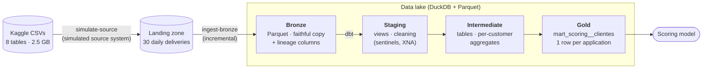
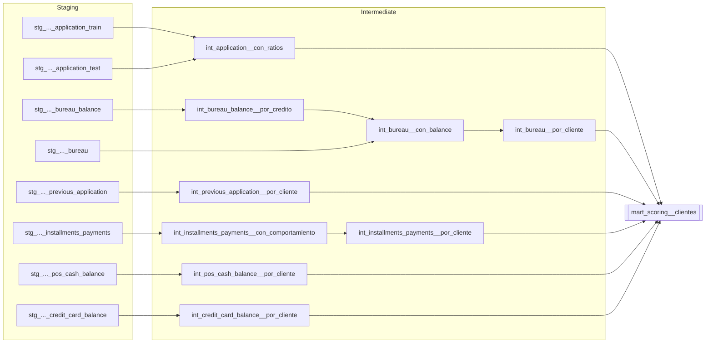
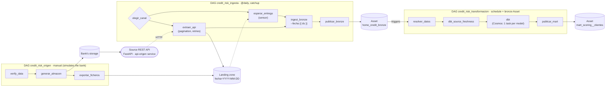
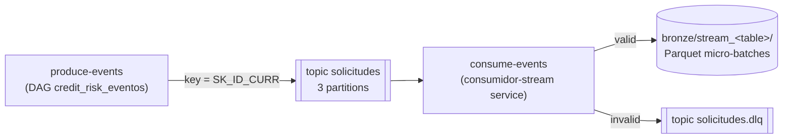
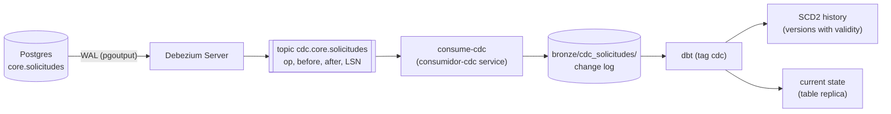

# Credit Risk Data Platform

🇬🇧 **English** · 🇪🇸 [Español](README.es.md)

[](https://github.com/att-22/credit-risk-data-platform/actions/workflows/ci.yml)

A data platform built from my master's thesis on credit *scoring*
([Home Credit Default Risk](https://www.kaggle.com/competitions/home-credit-default-risk/data) dataset).

The goal is to take the thesis ETL —written in notebooks with pandas— and turn it
into a professional data engineering project: versioned, tested, orchestrated
and deployable code.

> The code, model names and comments are in Spanish (the project started as a
> Spanish-language thesis); this README explains everything in English.

**Stack:** Python 3.13 · uv · DuckDB · Parquet · dbt (dbt-duckdb, dbt_utils,
dbt_expectations) · Apache Airflow 3 · astronomer-cosmos · FastAPI · httpx ·
Redpanda (Kafka) · confluent-kafka · PostgreSQL · Debezium · Apache Spark
(PySpark) · Delta Lake · pytest · ruff · pre-commit · GitHub Actions ·
Docker / Docker Compose

## Status

- [x] Phase 0 — Foundations: Git, packaging, tests, linting, CI with GitHub Actions, Docker
- [x] Phase 1 — Data modelling with dbt + DuckDB (medallion architecture)
- [x] Phase 2 — Orchestration with Airflow 3 (Cosmos, Assets, DAG tests)
- [x] Phase 3 — Realistic ingestion: incremental loads, API, streaming and CDC
- [x] Phase 4 — Spark, Delta Lake and Databricks
- [ ] Phase 5 — Cloud + Terraform + continuous deployment (in progress: Terraform and the lake on S3, on emulated AWS, done)

## Architecture

A *medallion* architecture on a local data lake: each layer has a single
responsibility and is built from the previous one.



| Layer | Tool | What it does |
|---|---|---|
| **Landing** | `simulate-source` ([simulate_source.py](src/credit_risk/simulate_source.py)) or `extract-api` ([extract_api.py](src/credit_risk/extract_api.py)) | The simulated source system splits the CSVs into 30 daily deliveries (`fecha=YYYY-MM-DD/<table>.csv.gz`), each customer arriving with their whole history on the same day, without losing a single row. Deliveries arrive as files or are extracted from its REST API. |
| **Bronze** | `ingest-bronze` ([ingest.py](src/credit_risk/ingest.py)) | **Incremental** ingestion: only the deliveries missing from the control table. Parquet partitioned by `fecha_entrega` (delivery date), types fixed by a schema contract ([esquemas_bronze.json](src/credit_risk/esquemas_bronze.json)), `_ingested_at` and `_source_file` columns. Atomic and idempotent. |
| **Staging** | dbt, views | Cleaning without changing the grain: the `365243` sentinel in `DAYS_*` columns and the `XNA` code become `NULL`. |
| **Intermediate** | dbt, **incremental** tables | Each customer's history aggregated into one row (mean, max, min, sum and the share of each category). Numeric columns are discovered by introspection; categories come from a fixed contract (a *seed*). Each run only recomputes customers with new data. |
| **Gold** | dbt, **incremental** table | Application + financial ratios + income capped at a frozen threshold (train p99.9) + the 5 aggregated histories. Train and test share the same table (`CONJUNTO` column). |

### dbt model lineage



The interactive graph is generated with `dbt docs generate && dbt docs serve`.

## Data quality

`dbt build` runs **58 data tests and 1 unit test** interleaved with the models:

- **Keys:** `unique` / `not_null` on every model and a composite key
  `(SK_ID_BUREAU, MONTHS_BALANCE)` on `bureau_balance`.
- **Referential integrity** (`relationships`): every customer with history has an
  application (`error`). Orphan records that come with the dataset itself are
  reported as `warn`: 43,041 credits in `bureau_balance` and 37,422 in `pos_cash_balance`.
- **Business rules:** ranges (`EXT_SOURCE_*` ∈ [0, 1], `DAYS_BIRTH` < 0,
  annuity ≤ credit...), accepted values and the number of mart rows per dataset.
- **Drift and schema:** default rate between 7% and 9% (`warn`), fixed number of
  mart columns, source categories within the contract (`warn`) and the frozen
  income cap still valid: the current p99.9 within 10% (`warn`).
- **Unit test** of the ratio and income-cap logic with hand-written rows
  (independent of the real data).
- **Source freshness** with `dbt source freshness` on `_ingested_at`.

### Incremental loading

The per-customer aggregates and the mart are **incremental** models
(`delete+insert` by key): each run only recomputes the customers with rows
ingested after the previous run (a watermark on `_ingested_at`, the ingestion
time rather than the data date, so late deliveries are never missed), always
with their full history. [`comprobar_paridad_incremental.py`](scripts/comprobar_paridad_incremental.py)
loads the data in batches, simulates a late delivery and checks that the mart is
identical to a full rebuild (`--full-refresh`); it runs in CI.

## Orchestration with Airflow

The pipeline is orchestrated with **Apache Airflow 3** on Docker Compose. One DAG
simulates the source system; ingestion is **daily** (each run processes the
delivery of its logical date) and is connected to the transformation through
**Assets**: the transformation is not scheduled by time, but whenever ingestion
publishes new data to bronze.



- **Ingestion by logical date:** the run for day X ingests the delivery for day X
  (`{{ ds }}`), so clearing a run or backfilling a range reprocesses exactly those
  days. With `catchup=True`, enabling the DAG creates one run per day of the
  simulated period.
- **Two input channels** (`canal` parameter, branching with `@task.branch`):
  - `ficheros` (files): the `esperar_entrega` sensor checks every 30 s that the
    source has left the complete delivery and frees its slot while waiting
    (`mode="reschedule"`).
  - `api`: [`extract-api`](src/credit_risk/extract_api.py) downloads the delivery
    from the [source API](src/credit_risk/api_origen.py) (FastAPI, `X-API-Key`
    header, cursor pagination) retrying on 429/5xx (exponential *backoff* with
    *jitter*, honouring `Retry-After`) and verifying the total row count. It
    writes the delivery to the landing zone with the same contract, so the rest of
    the pipeline does not change. The API simulates 5% failures to exercise the retries.
- **Assets with metadata:** the bronze event carries which dataset was ingested
  (`muestra` sample or `completo` full); the transformation reads it and processes
  that same dataset. Each dataset has its own lake, so a test run never overwrites
  the full data.
- **[astronomer-cosmos](https://github.com/astronomer/astronomer-cosmos):** reads
  the dbt `manifest.json` and creates one task per model (with its tests) and one
  per test that depends on several models. Each model gets its own logs and
  retries, and just part of the graph can be re-run.
- **`duckdb` pool with 1 slot:** DuckDB allows a single writer process, so the
  tasks that use it run one at a time.
- **Custom image:** Airflow and the project (dbt, pandas...) live in separate
  virtual environments inside the image so their dependencies never clash.
- **DAG tests in CI:** 35 tests load the DAGs inside the Airflow image and check
  their structure (Assets, pool, one task per manifest model, retries, commands
  present in the image...).

## Streaming with Redpanda (Kafka)

Besides the daily deliveries, the source can publish each application as an
**event** to the `solicitudes` topic on [Redpanda](https://redpanda.com/)
(Kafka API compatible). An always-on consumer writes them to bronze in micro-batches.



- **Producer** ([productor.py](src/credit_risk/productor.py)): `acks=all` and
  idempotence (network retries never duplicate); the `SK_ID_CURR` key sends all
  of a customer's events to the same partition, in order.
- **Consumer** ([consumidor.py](src/credit_risk/consumidor.py)): consumer group
  with a manual *commit* **after** each micro-batch is written (*at-least-once*:
  nothing is lost on a crash, but something may be repeated); validation against
  the same schema contract as batch ingestion; invalid events go to a **dead
  letter queue** with the reason in a header; graceful shutdown on `SIGTERM`.
- **Duplicates:** removed on read by `_evento_id`, because they can also come from
  republishing a day (new offsets), not only from re-reads.
- **Integration tests** against a real Redpanda in CI: DLQ, a crash between the
  write and the *commit* (verified with a mutation that commits before writing and
  loses events) and republishing.
- Redpanda web console (topics, messages, groups): http://localhost:8082.

## CDC: change data capture from the bank's database

The bank's application keeps the live state of each application in Postgres
(`core.solicitudes`) and keeps changing it (received → under review → approved
or rejected; some get deleted). **Debezium** reads the Postgres WAL through
logical replication and publishes every `INSERT`, `UPDATE` and `DELETE` to
Redpanda, without loading the database with queries and without missing
intermediate changes.



- Bronze keeps the **full change log**, not only the final state; the **LSN**
  (position in the WAL) orders the changes and is used for deduplication
  (consumption is *at-least-once*, with the same loop as the streaming consumer).
- dbt builds the **SCD type 2 history** (each version with its validity interval,
  for "what state was it in on day D?" queries) and the **replica** of the current
  state. The models are enabled with `--vars '{con_cdc: true}'`.
- [`comprobar_replica_cdc.py`](scripts/comprobar_replica_cdc.py) compares the
  replica with the actual Postgres table and checks that every application has all
  its versions: losing *inserts* does not change the final state, but it does
  change the history. It runs in CI against real Postgres, Debezium and Redpanda.

## Spark

[`spark_jobs/agregados.py`](spark_jobs/agregados.py) reimplements in PySpark the
aggregations of the largest tables (`bureau_balance`, 27M rows;
`installments_payments`, 13.6M) and
[`comprobar_paridad_spark.py`](scripts/comprobar_paridad_spark.py) verifies that
the result is identical to dbt's. Spark runs in a container (no Java needed on
Windows):

```bash
docker compose run --rm --service-ports spark spark-submit /opt/spark-jobs/agregados.py --explicar
```

With this data (~530 MB) DuckDB is about 5x faster: Spark pays a fixed cost (JVM,
task scheduling, *shuffle*) that only pays off when the data does not fit on one
machine and the work has to be spread across several.

### Delta Lake

[`spark_jobs/delta_lake.py`](spark_jobs/delta_lake.py) turns bronze and the
per-credit aggregate into **Delta tables**: Parquet plus a transaction log
(`_delta_log/`) that adds database guarantees:

- **ACID**: each write is an atomic *commit*; a half-written table is never read.
- **`MERGE`** (*upsert*): the aggregate is updated incrementally with only the
  credits that have new data; a late delivery **updates** its credits (25,390 in
  the test with day 15) instead of duplicating them.
- **Time travel**: each *commit* is a version that can be read again
  (`versionAsOf`) — the Phase 3 "read cutoff", natively.
- **Schema enforcement**: writing a column the table does not have is an error.
- **`OPTIMIZE`**: compacts the small files left behind by the `MERGE`s.

```bash
docker compose run --rm spark spark-submit /opt/spark-jobs/delta_lake.py cargar    # load
docker compose run --rm spark spark-submit /opt/spark-jobs/delta_lake.py historia  # history
uv run python scripts/comprobar_paridad_spark.py --delta   # Delta (read with deltalake) vs dbt
```

### Databricks

[`spark_jobs/databricks_demo.py`](spark_jobs/databricks_demo.py) is a notebook in
Databricks source format that runs the same pipeline on **Databricks Free
Edition** (serverless Spark, Unity Catalog, Delta built in): it reads the CSVs
from a *volume* with the project's schema contract, writes managed Delta tables,
reuses the functions of `agregados.py`, builds the per-credit aggregate with
`MERGE` (including a late delivery), shows `DESCRIBE HISTORY`, `VERSION AS OF`
and `OPTIMIZE`, and **checks itself** (the incremental aggregate must equal a
full computation). The same file runs locally and in CI.

1. Create a Databricks Free Edition account.
2. **Workspace → Create → Git folder** with this repository's URL.
3. In **Catalog → workspace**, create a schema `credit_risk` with a volume
   `muestra`, and upload `bureau_balance.csv` and `installments_payments.csv`
   from [tests/fixtures/muestra/raw](tests/fixtures/muestra/raw).
4. Open `spark_jobs/databricks_demo.py` from the Git folder and click **Run all**
   (the widgets default to `/Volumes/workspace/credit_risk/muestra` and
   `workspace.credit_risk`).

## Infrastructure as code (Terraform + AWS)

[`infra/`](infra) declares the platform's AWS infrastructure with Terraform: an S3
bucket for the lake (versioning, AES256 encryption, public access blocked, a
lifecycle rule that expires `landing/`) and a least-privilege IAM role for the
pipeline that can only read and write inside the lake's four zones.

It runs for free, with no AWS account, against [Moto](https://github.com/getmoto/moto),
an open-source AWS emulator; the only difference from real AWS is one variable
(`endpoint_aws`). Terraform itself runs in a container:

```bash
docker compose --profile aws up -d moto        # AWS emulator on port 5000
docker compose --profile aws run --rm terraform init
docker compose --profile aws run --rm terraform apply -var-file=entornos/local.tfvars
uv run --group aws python scripts/comprobar_infra.py   # independent check with boto3
```

`scripts/comprobar_infra.py` does not trust Terraform: it asks the AWS API whether
the bucket, the lifecycle rules and the role's permissions are the declared ones.

**The lake on S3.** With `LAKE_URI=s3://<bucket>` the landing zone and bronze live in
the bucket instead of on disk, and nothing else in the pipeline changes: DuckDB reads
and writes the data through `httpfs`, `pyarrow.fs` handles the folders with the same
API for disk and S3 ([`lago.py`](src/credit_risk/lago.py)), and dbt uses an `s3`
target. The dbt warehouse stays local, so storage and compute are separate.
`scripts/comprobar_paridad_s3.py` runs the whole pipeline twice, on disk and on S3,
and requires the same bronze files and the same mart, column by column.
[infra/README.md](infra/README.md) has the details, the Moto quirks found along the
way and an AWS / Google Cloud / Azure equivalence table.

## Findings about the data

- **Sentinel 365243** (= 1,000 years) means "no data" in 6 `DAYS_*` columns. In
  `DAYS_EMPLOYED` it covers 55,374 applications (retirees and unemployed).
  Without cleaning it, the mean goes from −2,384 to +63,815 days.
- **There is a real customer with `SK_ID_CURR = 365243`.** The thesis replaced the
  sentinel across the whole table and wiped that customer's history. Here it is
  cleaned column by column.
- **Parity with the thesis:** 0 numeric differences on the shared features. The
  only discrepancies are explained: `sum()` of all nulls (0 in pandas, `NULL` in
  SQL), customer 365243, and cents in `INST_PAGO_DIF` because the thesis
  subtracted in float32.

## Getting started

Requirements: [uv](https://docs.astral.sh/uv/) (it installs the right Python version).

```bash
uv sync                         # virtual environment + dependencies (uv.lock)
cp .env.example .env            # and set DATA_DIR to your data folder
```

### Try it without downloading the Kaggle data

The repository includes a **synthetic sample** (314 customers, 2.3 MB) in
[tests/fixtures/muestra](tests/fixtures/muestra), generated with
[scripts/crear_muestra.py](scripts/crear_muestra.py). It keeps the relationships
between tables, the types and the categories, but each column's values are
shuffled, so no row matches a real customer. CI uses it too.

```bash
export DATA_DIR=tests/fixtures/muestra
uv run verify-data              # checks the input CSVs
uv run simulate-source          # CSV -> lake/landing (daily deliveries)
uv run ingest-bronze            # landing -> lake/bronze (only new deliveries)
cd transform
uv run dbt deps                 # dbt packages
uv run dbt build                # models + tests (~2 s with the sample)
```

### With the full data

Download the CSVs from [Kaggle](https://www.kaggle.com/competitions/home-credit-default-risk/data)
into `<DATA_DIR>/raw/`, set `DATA_DIR` in `.env` and run the same commands
(without the `export`). With the full data, `dbt build` takes about 25 s.

### Airflow

```bash
docker compose up -d --build    # Airflow, source API, Redpanda, core banking DB, Debezium and consumers
```

Open http://localhost:8080 (no login: local-only configuration), trigger
`credit_risk_origen` (it generates the "bank's" deliveries: the API serves them at
http://localhost:8000/docs and a copy lands in the landing zone) and enable
`credit_risk_transformacion` and `credit_risk_ingesta`: ingestion processes the 30
days one by one and each day triggers the transformation. The sample is used by
default; for the full data, trigger the source DAG with `datos = completo` and a
backfill of the ingestion with the same parameter. With `canal = api`, ingestion
extracts the deliveries from the API instead of waiting for files. To stop it:
`docker compose down` (the volumes with the lake and the run history are kept).

Compose reads `DATA_DIR` from `.env`; with `datos = muestra` the Kaggle data is not
needed (the synthetic sample ships inside the image).

### Docker

```bash
docker build -t credit-risk .
docker run --rm -v "<path to DATA_DIR>:/data:ro" credit-risk   # verify-data
```

In Git Bash (Windows), prefix `docker run` with `MSYS_NO_PATHCONV=1`.

## Repository layout

```
├── src/credit_risk/       # Python package: config, source simulator, ingestion,
│                          #   source API and extraction, streaming and CDC
├── transform/             # dbt project
│   ├── models/staging/        # cleaning (views)
│   ├── models/intermediate/   # per-customer aggregates (incremental tables)
│   ├── models/marts/          # final scoring table
│   ├── models/cdc/            # SCD2 history and replica of the core banking DB
│   ├── seeds/                 # category contract
│   ├── macros/                # cleaning, aggregation, read cutoff, watermark
│   └── tests/                 # singular tests
├── orchestration/         # Airflow and the simulated "bank" services
│   ├── Dockerfile             # Airflow image + Cosmos + the project (separate venv)
│   ├── dags/                  # source, ingestion, transformation, events and core DAGs
│   ├── tests/                 # DAG integrity tests
│   ├── core_bancario/         # schema of the bank's Postgres
│   └── debezium/              # Debezium Server configuration
├── spark/ · spark_jobs/   # Spark + Delta image and PySpark jobs
├── infra/                 # Terraform: S3 lake and IAM role on AWS (emulated with Moto)
├── compose.yaml           # the whole local environment with Docker Compose
├── scripts/               # synthetic sample, schema contract and parity checks
├── tests/                 # pytest tests (unit and integration) and data sample
├── .github/workflows/     # CI: 11 jobs
└── Dockerfile             # multi-stage project image, non-root user
```

## Continuous integration

On every PR, GitHub Actions runs in parallel:

- **Lint:** `ruff check` and `ruff format --check`.
- **Tests:** pytest on Ubuntu and Windows.
- **dbt build (sample):** the full pipeline `verify-data → simulate-source → ingest-bronze → dbt build → dbt source freshness` on the synthetic sample, plus the parity between incremental loading and a full rebuild.
- **Streaming (Redpanda):** starts a broker and runs the producer and consumer integration tests.
- **Spark:** tests of the PySpark and Delta Lake jobs (with Java 17), parity with dbt on the sample and the Databricks notebook in local mode.
- **CDC (Postgres + Debezium):** starts Postgres, Debezium and Redpanda, captures a day of changes and checks that the dbt replica is identical to Postgres.
- **Terraform (emulated AWS):** `fmt`, `validate`, `apply` against Moto, a second `plan` with no changes, a boto3 check of the resources and `destroy`.
- **Lake on S3 (emulated AWS):** Terraform creates the bucket in Moto and the pipeline runs on it: lake access tests against S3, same bronze and mart as on disk, and incremental-load parity on S3.
- **Airflow DAGs:** builds the Airflow image and runs the DAG integrity tests inside it.
- **Docker build:** builds the image and runs a smoke test.

`main` is protected: it can only change through a PR, with green CI and
*squash merge*.

## Data

The original data is **not** in this repository (it is 2.5 GB and subject to the
Kaggle competition licence). It is read from the folder set in the `DATA_DIR`
environment variable; the lake (`lake/`) is generated locally.
