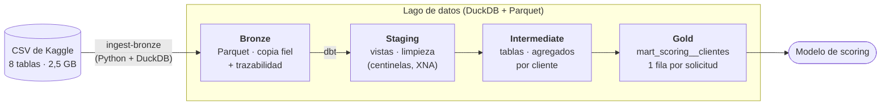
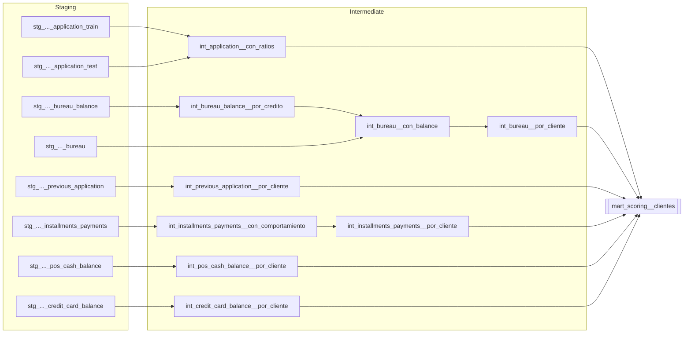

# Credit Risk Data Platform

[](https://github.com/att-22/credit-risk-data-platform/actions/workflows/ci.yml)

Plataforma de datos construida a partir de mi TFM de *scoring* crediticio
(dataset [Home Credit Default Risk](https://www.kaggle.com/competitions/home-credit-default-risk/data)).

El objetivo es llevar la ETL del TFM —hecha en notebooks con pandas— a un
proyecto de ingeniería de datos profesional: código versionado, testeado,
orquestado y desplegable.

**Stack:** Python 3.13 · uv · DuckDB · Parquet · dbt (dbt-duckdb, dbt_utils,
dbt_expectations) · pytest · ruff · pre-commit · GitHub Actions · Docker

## Estado

- [x] Fase 0 — Bases: Git, empaquetado, tests, lint, CI con GitHub Actions, Docker
- [x] Fase 1 — Modelado de datos con dbt + DuckDB (arquitectura medallion)
- [ ] Fase 2 — Orquestación con Airflow
- [ ] Fase 3 — Ingesta incremental y streaming
- [ ] Fase 4 — Procesamiento distribuido con Spark
- [ ] Fase 5 — Cloud + Terraform + despliegue continuo

## Arquitectura

Arquitectura *medallion* en un lago de datos local: cada capa tiene una
responsabilidad única y se construye a partir de la anterior.



| Capa | Herramienta | Qué hace |
|---|---|---|
| **Bronze** | `ingest-bronze` ([ingest.py](src/credit_risk/ingest.py)) | CSV → Parquet (zstd), con columnas `_ingested_at` y `_source_file`. Escritura atómica e idempotente. 2,5 GB → ~530 MB en ~10 s. |
| **Staging** | dbt, vistas | Limpieza sin cambiar la granularidad: el centinela `365243` de las columnas `DAYS_*` y el código `XNA` pasan a `NULL`. |
| **Intermediate** | dbt, tablas | Agregación del historial a una fila por cliente (media, máximo, mínimo, suma y proporción de cada categoría) con una macro que descubre las columnas por introspección. |
| **Gold** | dbt, tabla | Solicitud + ratios financieros + recorte de ingresos al p99,9 (calculado solo con train) + los 5 historiales agregados. Train y test en la misma tabla (columna `CONJUNTO`). |

### Linaje de los modelos dbt



El grafo interactivo se genera con `dbt docs generate && dbt docs serve`.

## Calidad de datos

`dbt build` ejecuta **55 tests de datos y 1 test unitario** intercalados con los modelos:

- **Claves:** `unique` / `not_null` en cada modelo y clave compuesta
  `(SK_ID_BUREAU, MONTHS_BALANCE)` en `bureau_balance`.
- **Integridad referencial** (`relationships`): todo cliente con historial
  tiene solicitud (`error`). Los créditos huérfanos del propio dataset se
  reportan como `warn`: 43.041 en `bureau_balance` y 37.422 en `pos_cash_balance`.
- **Reglas de negocio:** rangos (`EXT_SOURCE_*` ∈ [0, 1], `DAYS_BIRTH` < 0,
  cuota ≤ crédito...), valores aceptados y nº de filas del mart por conjunto.
- **Deriva y esquema:** tasa de impago entre 7 % y 9 % (`warn`) y nº de
  columnas del mart fijo (detecta categorías nuevas o desaparecidas).
- **Test unitario** de la lógica de ratios y del recorte de ingresos con datos
  inventados (sin depender de los datos reales).
- **Frescura** de las fuentes con `dbt source freshness` sobre `_ingested_at`.

## Hallazgos sobre los datos

- **Centinela 365243** (= 1000 años) significa "sin dato" en 6 columnas
  `DAYS_*`. En `DAYS_EMPLOYED` son 55.374 solicitudes (jubilados y
  desempleados). Sin limpiarlo, la media pasa de −2.384 a +63.815 días.
- **Hay un cliente real con `SK_ID_CURR = 365243`.** El TFM reemplazaba el
  centinela en toda la tabla y le borraba el historial. Aquí se limpia
  columna a columna.
- **Paridad con el TFM:** 0 diferencias numéricas en las variables comunes. Las
  únicas discrepancias están explicadas: `sum()` de todo nulos (0 en pandas,
  `NULL` en SQL), el cliente 365243, y céntimos en `INST_PAGO_DIF` porque el
  TFM restaba en float32.

## Puesta en marcha

Requisitos: [uv](https://docs.astral.sh/uv/). uv instala la versión de Python adecuada.

```bash
uv sync                         # entorno virtual + dependencias (uv.lock)
cp .env.example .env            # y ajusta DATA_DIR a tu carpeta de datos
```

### Probar sin descargar los datos de Kaggle

El repositorio incluye una **muestra sintética** (314 clientes, 2,3 MB) en
[tests/fixtures/muestra](tests/fixtures/muestra), generada con
[scripts/crear_muestra.py](scripts/crear_muestra.py). Conserva las relaciones
entre tablas, los tipos y las categorías, pero los valores de cada columna
están barajados, así que ninguna fila corresponde a un cliente real. Es la que
usa la CI.

```bash
export DATA_DIR=tests/fixtures/muestra
uv run verify-data              # comprueba los CSV de entrada
uv run ingest-bronze            # CSV -> lake/bronze/*.parquet
cd transform
uv run dbt deps                 # paquetes de dbt
uv run dbt build                # modelos + tests (~2 s con la muestra)
```

### Con los datos completos

Descarga los CSV de [Kaggle](https://www.kaggle.com/competitions/home-credit-default-risk/data)
en `<DATA_DIR>/raw/`, define `DATA_DIR` en `.env` y ejecuta los mismos comandos
(sin el `export`). Con los datos completos, `dbt build` tarda unos 25 s.

### Docker

```bash
docker build -t credit-risk .
docker run --rm -v "<ruta a DATA_DIR>:/data:ro" credit-risk   # verify-data
```

En Git Bash (Windows) hay que anteponer `MSYS_NO_PATHCONV=1` a `docker run`.

## Estructura

```
├── src/credit_risk/       # paquete Python: configuración, verificación e ingesta
├── transform/             # proyecto dbt
│   ├── models/staging/        # limpieza (vistas)
│   ├── models/intermediate/   # agregaciones por cliente (tablas)
│   ├── models/marts/          # tabla final de scoring
│   ├── macros/                # limpieza y agregar_por_cliente
│   └── tests/                 # tests singulares
├── scripts/               # utilidades (generar la muestra sintética)
├── tests/                 # tests de pytest y muestra de datos
├── .github/workflows/     # CI: lint, tests (Linux + Windows), dbt, Docker
└── Dockerfile             # imagen multi-stage, usuario sin root
```

## Integración continua

En cada PR, GitHub Actions ejecuta en paralelo:

- **Lint:** `ruff check` y `ruff format --check`.
- **Tests:** pytest en Ubuntu y Windows.
- **dbt build (muestra):** el pipeline completo `verify-data → ingest-bronze → dbt build → dbt source freshness` sobre la muestra sintética.
- **Docker build:** construcción de la imagen y prueba de humo.

`main` está protegida: solo se puede cambiar mediante PR, con la CI en verde y
*squash merge*.

## Datos

Los datos originales **no** están en este repositorio (pesan 2,5 GB y tienen la
licencia de la competición de Kaggle). Se leen desde la carpeta indicada en la
variable de entorno `DATA_DIR`; el lago (`lake/`) se genera localmente.
